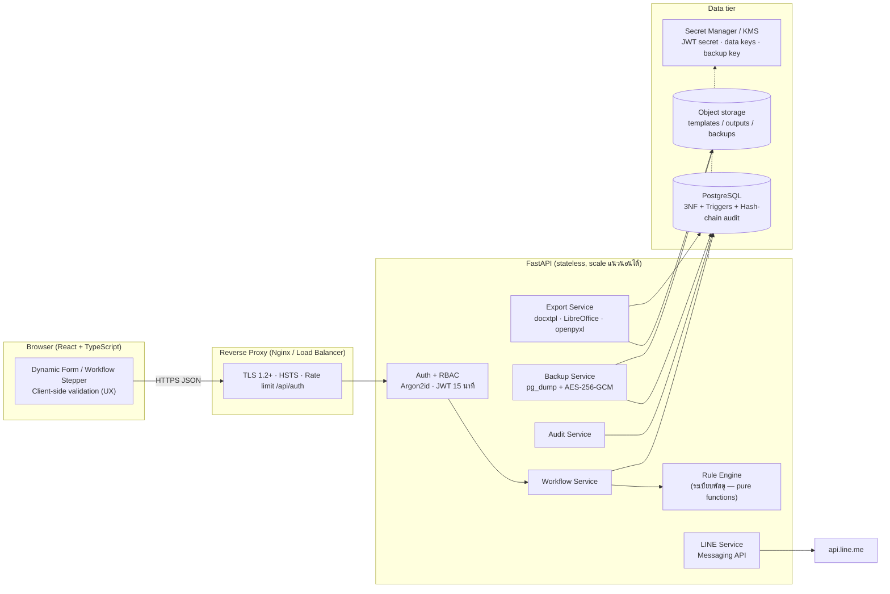
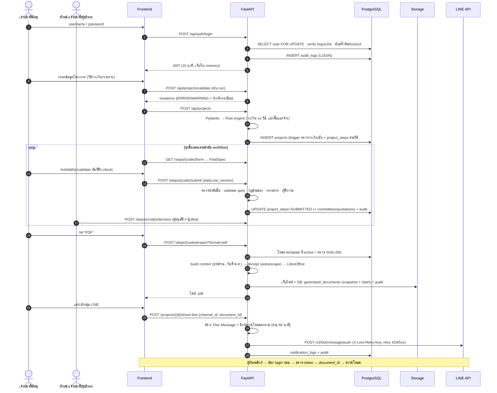

# 1. System Architecture & Workflow

## 1.1 ภาพรวมสถาปัตยกรรม



| Layer | เทคโนโลยี | เหตุผลที่เลือก |
|---|---|---|
| Frontend | React 18 + TypeScript (Vite) | ฟอร์มสร้างจาก JSON spec ได้ง่าย, React escape ข้อความอัตโนมัติ (กัน XSS) |
| Backend | Python FastAPI + Pydantic v2 + SQLAlchemy 2 | validation แบบ declarative, ORM สร้าง parameterized query เสมอ, ecosystem เอกสาร (docxtpl/openpyxl) ดีที่สุดใน Python |
| Database | PostgreSQL 14+ | NUMERIC(15,2) สำหรับเงิน, JSONB, partial unique index, trigger/PLpgSQL, `pg_dump` |
| Document | docxtpl (Jinja ใน .docx), LibreOffice headless (→PDF), openpyxl | ใช้ไฟล์แบบฟอร์มกรมบัญชีกลางต้นฉบับเป็น template → หน้าตาเหมือนต้นฉบับ 100% |
| แจ้งเตือน | LINE Messaging API (push) | **LINE Notify ยุติบริการ 31 มี.ค. 2568** แล้ว จึงใช้ Messaging API |

### หลักการออกแบบสำคัญ

1. **Rule engine แยกจาก framework** (`backend/app/rules/`) — กฎระเบียบพัสดุทั้งหมดเป็น pure function ทดสอบได้โดยไม่ต้องมี DB เมื่อกฎหมาย/หนังสือเวียนเปลี่ยน แก้ที่เดียว
2. **Workflow ขับเคลื่อนด้วยข้อมูล** — ลำดับขั้นตอนอยู่ในตาราง `workflow_steps` (ไม่ hard-code ใน UI) รวมขั้นตอนแบบมีเงื่อนไข เช่น `PUBLIC_HEARING` จะปรากฏเฉพาะ e-bidding วงเงิน > 5 ล้านบาท
3. **Form spec เป็นแหล่งความจริงเดียว** (`step_forms.py`) — backend ส่ง FieldSpec ให้ frontend สร้างฟอร์ม และใช้ spec เดียวกันตรวจซ้ำฝั่งเซิร์ฟเวอร์
4. **Defense in depth** — Validation 3 ชั้น: Frontend → Pydantic/Rule engine → DB constraint/trigger
5. **CGD Forms Only** — ระบบไม่ "วาด" แบบฟอร์มเอง; ใช้ได้เฉพาะ template ที่ลงทะเบียนพร้อม `source_url` จาก `gprocurement.go.th` และผ่านการรับรองโดยผู้ใช้คนที่สอง

## 1.2 Flow การทำงาน: Login → สร้างเอกสาร → ส่ง LINE



## 1.3 Dynamic Workflow ตามวิธีจัดหา

ลำดับขั้นตอนอยู่ใน `database/seed.sql` (ตาราง `workflow_steps`) — แต่ละขั้นผูกกับ "ประเภทเอกสาร" ที่ต้องออก และ "ประเภทคณะกรรมการ" ที่ต้องแต่งตั้ง

| ลำดับ | วิธีเฉพาะเจาะจง | วิธีคัดเลือก | e-bidding | e-market |
|---|---|---|---|---|
| 1 | สร้างโครงการ | สร้างโครงการ | ขออนุมัติหลักการ | สร้างโครงการ |
| 2 | รายงานขอซื้อขอจ้าง / แต่งตั้งผู้ตรวจรับ (ข้อ 22, 79) | รายงานขอซื้อขอจ้าง / แต่งตั้งกรรมการคัดเลือก (ข้อ 22, 74) | แต่งตั้งกรรมการร่าง TOR และราคากลาง (ข้อ 21) | รายงานขอซื้อขอจ้าง / แต่งตั้งกรรมการ |
| 3 | บันทึกตกลงราคา (ข้อ 79) | หนังสือเชิญชวน ≥ 3 ราย (ม. 56(1)) | จัดทำ TOR และราคากลาง | อนุมัติประกาศและเอกสาร |
| 4 | รายงานผลพิจารณาและขออนุมัติสั่งซื้อ / ประกาศผู้ชนะ (ม. 66) | รายงานผลการพิจารณา | *รับฟังความคิดเห็นร่าง TOR (เฉพาะ > 5 ล้าน, ข้อ 45)* | รายงานผลการพิจารณา |
| 5 | **ออกใบสั่งซื้อ/สั่งจ้าง (PO)** | ขออนุมัติสั่งซื้อ / ประกาศผู้ชนะ | รายงานขอซื้อขอจ้าง / แต่งตั้งกรรมการพิจารณาผล | ขออนุมัติสั่งซื้อ / ประกาศผู้ชนะ |
| 6 | | ลงนามสัญญา (หลังพ้นอุทธรณ์ ม. 117) | อนุมัติประกาศและเอกสารประกวดราคา (ระยะประกาศขั้นต่ำคำนวณตามวงเงิน) | ลงนามสัญญา |
| 7 | | | รายงานผลการพิจารณา | |
| 8 | | | ขออนุมัติสั่งซื้อสั่งจ้าง / ประกาศผู้ชนะ | |
| 9 | | | ลงนามสัญญา | |

กฎการเดินขั้นตอน (`workflow_service.py`):

- เริ่มขั้น N ได้เมื่อขั้น 1…N-1 เป็น `APPROVED`/`SKIPPED` ทั้งหมด
- `PENDING/REJECTED → SUBMITTED` (ผู้เสนอ) → `APPROVED/REJECTED` (ผู้อนุมัติซึ่งต้องไม่ใช่ผู้เสนอ)
- ส่งแล้วแก้ไม่ได้จนกว่าจะถูกส่งกลับ (`REJECTED`)
- สร้างเอกสารได้เฉพาะขั้นที่ `SUBMITTED/APPROVED` (ข้อมูลผ่าน validation แล้วเท่านั้น)
- อนุมัติ `AWARD_APPROVAL` → สถานะโครงการ `AWARDED`; อนุมัติขั้นสุดท้าย → `COMPLETED`/`CONTRACTED`

## 1.4 โครงสร้างโค้ด

```
backend/app/
├── main.py                 # app, security headers, error mapping กลาง
├── core/                   # config · database · security (Argon2/JWT/RBAC) · crypto (AES-GCM)
├── rules/                  # ★ กฎระเบียบพัสดุ (pure): procurement_rules · step_forms · validators
├── services/               # workflow · export · line · backup · audit
├── api/                    # auth · projects · registry · documents · dashboard · admin
├── models.py · schemas.py
frontend/src/
├── validation.ts           # ★ ตรรกะเดียวกับ backend (UX)
├── components/DynamicStepForm.tsx · WorkflowStepper.tsx
database/schema.sql · seed.sql
```
