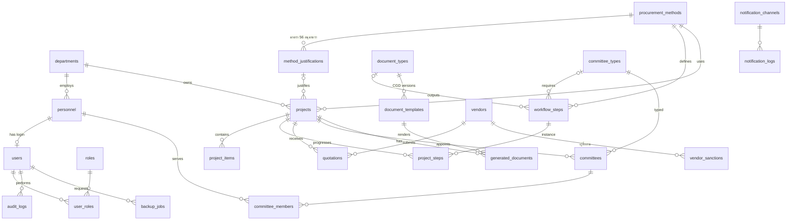

# 2. Database Schema (PostgreSQL, 3NF)

ไฟล์จริง: [`database/schema.sql`](../database/schema.sql) · ข้อมูลอ้างอิง: [`database/seed.sql`](../database/seed.sql)

## 2.1 ER Diagram

## 2.2 ตาราง, PK และ FK

| ตาราง | PK | FK / Unique ที่สำคัญ | หน้าที่ |
|---|---|---|---|
| `departments` | department_id | parent_department_id → departments | หน่วยงาน (รองรับลำดับชั้น) |
| **`personnel`** | personnel_id | department_id → departments · UQ citizen_id_hmac | บุคลากร (เลขบัตร **เข้ารหัส** + blind index) |
| `users` | user_id | personnel_id → personnel (UQ) · UQ username | บัญชีเข้าระบบ, ตัวนับ login ผิด/ล็อก |
| `roles`, `user_roles` | role_id · (user_id, role_id) | → users, roles | RBAC แบบ many-to-many |
| `procurement_methods` | method_id | UQ code | วิธีจัดหา + ช่วงวงเงินที่อนุญาต |
| `method_justifications` | justification_id | method_id → procurement_methods · UQ(method_id, clause_ref) | เหตุผลตามมาตรา 56 (มีเพดานรายอนุมาตรา เช่น 56(2)(ข) ≤ 500,000) |
| `workflow_steps` | step_id | method_id → methods · output_document_type_id → document_types · required_committee_type_id → committee_types · UQ(method_id, step_order) | นิยามขั้นตอนต่อวิธี |
| **`vendors`** | vendor_id | UQ tax_id (CHECK 13 หลัก) | ผู้ประกอบการ (เบอร์/บัญชี **เข้ารหัส**) |
| `vendor_sanctions` | sanction_id | vendor_id → vendors | ประวัติผู้ทิ้งงาน/ถูกระงับ |
| **`projects`** | project_id | department_id, method_id, justification_id, created_by · UQ project_code, egp_project_no | โครงการ + `row_version` (optimistic lock) |
| `project_items` | item_id | project_id → projects · UQ(project_id, line_no) | รายการพัสดุ (ยอดรวมคำนวณใน view) |
| `project_steps` | (project_id, step_id) | → projects, workflow_steps, users · CHECK approved_by ≠ submitted_by | สถานะขั้นตอน + ข้อมูลฟอร์ม (JSONB) |
| `quotations` | quotation_id | → projects, vendors · UQ(project_id, vendor_id) · partial UQ ผู้ชนะ 1 ราย | ใบเสนอราคา/ผลพิจารณา |
| **`committees`** | committee_id | → projects, committee_types · UQ(project_id, committee_type_id) | คำสั่งแต่งตั้งกรรมการต่อโครงการ |
| `committee_members` | (committee_id, personnel_id) | → committees, personnel · partial UQ ประธาน 1 คน | กรรมการรายบุคคล + บทบาท |
| **`document_templates`** | template_id | document_type_id → document_types · CHECK source_url = gprocurement.go.th · CHECK verified_by ≠ uploaded_by · partial UQ active 1 ฉบับ/ประเภท | ทะเบียนแบบฟอร์มกรมบัญชีกลาง (+SHA-256) |
| `generated_documents` | document_id | → projects, document_templates, users | ประวัติเอกสารที่สร้าง + snapshot ข้อมูล + hash |
| `notification_channels`, `notification_logs` | channel_id · notification_id | UQ retry_key | กลุ่ม LINE (groupId เข้ารหัส), ประวัติการส่ง |
| `backup_jobs` | backup_job_id | requested_by → users | ประวัติสำรอง/กู้คืน |
| **`audit_logs`** | audit_id | user_id → users · UQ row_hash | append-only + hash chain |

## 2.3 เหตุผลด้าน Normalization (3NF)

- **1NF**: ไม่มี repeating group — รายการพัสดุ, กรรมการ, ใบเสนอราคา แยกเป็นตารางลูก ไม่ใช่คอลัมน์ `item1, item2…`
- **2NF**: ตารางที่มี composite key (`project_steps`, `committee_members`, `user_roles`) ทุกคอลัมน์ขึ้นกับ key ทั้งชุด เช่น `member_role` ขึ้นกับ (คณะ, บุคคล) ไม่ใช่บุคคลอย่างเดียว
- **3NF**: ตัด transitive dependency
  - `category`/ชื่อวิธี อยู่ที่ `procurement_methods` ไม่ซ้ำใน `projects`
  - `line_total = quantity × unit_price` และยอดรวมโครงการ **ไม่เก็บ** → `v_project_totals`
  - ชื่อ/ตำแหน่งกรรมการ อ้างจาก `personnel` ไม่คัดลอกลง `committee_members`
  - ชื่อผู้ประกอบการอ้างจาก `vendors` ผ่าน `vendor_id`
- **ข้อยกเว้นโดยเจตนา (ไม่ผิด 3NF)**: `generated_documents.render_context` เป็น *snapshot ณ เวลาออกเอกสาร* ไม่ใช่ข้อมูลที่ต้อง sync — เป็นหลักฐานทางราชการว่าเอกสารฉบับนั้นออกด้วยข้อมูลอะไร แม้ภายหลังจะแก้ทะเบียนผู้ประกอบการ
- `project_steps.step_data` (JSONB) เก็บค่าที่ **ผ่าน validation แล้ว** ของฟอร์มแต่ละขั้น — ข้อมูลที่ระบบอื่นต้อง query/join (ผู้ชนะ, ราคา, กรรมการ) ถูก "ยก" ไปลงตารางหลัก (`quotations`, `committees`) ใน `_apply_side_effects`

## 2.4 กฎที่บังคับในระดับฐานข้อมูล (ด่านสุดท้าย)

| กลไก | กฎ |
|---|---|
| `trg_projects_budget` | วงเงินต้องอยู่ในช่วงของวิธี, คัดเลือก/เฉพาะเจาะจงต้องมีเหตุผล, เหตุผลต้องตรงวิธี, ไม่เกินเพดานรายอนุมาตรา |
| `trg_committee_conflict` | บุคคลเดียวกันเป็นกรรมการพิจารณาผล/คัดเลือก **และ** กรรมการตรวจรับในโครงการเดียวกันไม่ได้ |
| `trg_audit_hash` / `trg_audit_no_update` | audit เป็น hash chain และห้าม UPDATE/DELETE |
| `fn_verify_audit_chain()` | ตรวจหาแถวแรกที่ chain ขาด |
| CHECK / partial UNIQUE | ผู้อนุมัติ ≠ ผู้เสนอ, ประธาน 1 คน, ผู้ชนะ 1 ราย, template active 1 ฉบับ, template ต้องมาจาก gprocurement.go.th |
| `NUMERIC(15,2)` | เงินทุกช่อง — ไม่ใช้ float |

ทดสอบ trigger จริงบน PostgreSQL 16 แล้ว (ดู `backend/tests/test_api_flow.py`)
