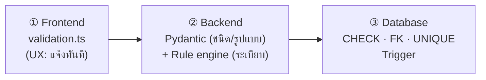

# 3. Security & Validation Logic

## 3.1 Validation 3 ชั้น

| ชั้น | ตรวจอะไร | ถ้าข้ามชั้นนี้ไปได้? |
|---|---|---|
| ① Frontend | ทุกกฎที่รู้ได้จากข้อมูลบนหน้าจอ | ไม่เป็นไร — ชั้น ② ตรวจซ้ำทั้งหมด (frontend **ไม่ใช่** security boundary) |
| ② Backend | ชนิด/ความยาว/รูปแบบ, ฟิลด์เกิน (mass assignment), กฎระเบียบ, สิทธิ์, ลำดับขั้นตอน | — |
| ③ Database | กฎหลักที่ "ห้ามผิดเด็ดขาด" แม้มีบั๊กใน backend หรือมีคนเขียนตรงเข้า DB | — |

**ลำดับการตรวจก่อนบันทึกขั้นตอน** (`workflow_service.submit_step`)

1. ผู้ใช้มีสิทธิ์ `step:submit` (RBAC)
2. `row_version` ตรงกับปัจจุบัน (กันบันทึกทับกันเมื่อ 2 คนแก้พร้อมกัน → 409)
3. ขั้นตอนก่อนหน้าอนุมัติครบ และขั้นนี้ยังไม่ถูกล็อก
4. ไม่มีฟิลด์นอก spec · ทุกช่องตรงชนิด/ช่วง · ช่อง `show_if` ที่มองเห็นต้องกรอก
5. กฎข้ามช่อง (`lte_field`) + กฎระเบียบเฉพาะขั้น (กรรมการ, วงเงิน, วันที่)
6. ผลข้างเคียง: ผู้ประกอบการต้องอยู่ในทะเบียนและไม่อยู่ในบัญชีผู้ทิ้งงาน, ผู้ชนะต้องเป็นผู้ยื่นข้อเสนอ
7. DB trigger ตรวจอีกรอบตอน flush → ทั้งหมดอยู่ใน transaction เดียว (ผิดข้อใด rollback ทั้งหมด รวม audit log)

ผลตรวจคืนเป็นรายการ `{code, message, field, legal_ref, severity}` **ทุกข้อพร้อมกัน** — `ERROR` ห้ามบันทึก, `WARNING` บันทึกได้เมื่อผู้ใช้ยืนยัน (`acknowledge_warnings`)

## 3.2 กฎระเบียบที่ระบบตรวจ

| กฎ | ระดับ | อ้างอิง | ตำแหน่งในโค้ด |
|---|---|---|---|
| เลขประจำตัวผู้เสียภาษี 13 หลัก + checksum mod 11 | ERROR | — | `validators.is_valid_thai_tax_id`, `validation.ts` |
| นิติบุคคลต้องขึ้นต้นด้วย 0 / บุคคลธรรมดาไม่ขึ้นต้น 0 | ERROR | — | `schemas.VendorCreate` |
| e-market/e-bidding ต้องวงเงิน > 500,000 | ERROR | ม. 55(1), 56(2)(ข) | rule engine + trigger |
| เฉพาะเจาะจงตาม 56(2)(ข) วงเงิน ≤ 500,000 | ERROR | ม. 56(2)(ข) + กฎกระทรวง 2560 | rule engine + trigger |
| คัดเลือก/เฉพาะเจาะจง ต้องระบุอนุมาตรา | ERROR | ม. 56 | Pydantic + rule engine + trigger |
| ยอดรวมรายการพัสดุ ≤ วงเงิน | ERROR | ข้อ 22(4) | rule engine |
| ราคากลางสูงกว่าวงเงิน | WARNING | ข้อ 57 | rule engine |
| ราคาที่ตกลง/สั่งซื้อ ≤ วงเงิน (เว้นอนุมัติเงินเพิ่ม) | ERROR | ข้อ 57 | `validate_award` + `validation.ts` |
| ราคาที่ตกลง ≤ ราคาที่เสนอ | ERROR | ข้อ 79 | `lte_field` |
| ผู้ตรวจรับคนเดียวได้เฉพาะ ≤ 100,000 / คณะ ≥ 3 คน มีประธาน 1 | ERROR | ข้อ 25 | `validate_committee` |
| กรรมการพิจารณาผล ≠ กรรมการตรวจรับ (โครงการเดียวกัน) | ERROR | ข้อ 26 | trigger `trg_committee_conflict` |
| กรรมการมีส่วนได้เสีย | ERROR | ม. 13 | `validate_committee` |
| วิธีคัดเลือกเชิญ ≥ 3 ราย | WARNING | ม. 56(1) | `validate_quotations`, `min_items` |
| ผู้ประกอบการอยู่ในบัญชีผู้ทิ้งงาน | ERROR | ม. 109 | `_eligible_vendor` |
| อัตราค่าปรับรายวัน 0.01–0.20% | ERROR | ข้อ 162 | FieldSpec ของ PO |
| สงสัยแบ่งซื้อแบ่งจ้าง (30 วัน รวม > 500,000) | WARNING | หลักห้ามแบ่งซื้อแบ่งจ้าง | `detect_split_purchase` |
| รับฟังความคิดเห็นร่าง TOR เมื่อ > 5 ล้าน | ขั้นตอนบังคับ | ข้อ 45 | `applies_when_budget_over` |
| ระยะประกาศ e-bidding ขั้นต่ำตามวงเงิน (5/10/12/20 วันทำการ) | ข้อมูลช่วยวางแผน | ข้อ 46 | `e_bidding_min_announce_days` |
| ผู้อนุมัติ ≠ ผู้เสนอ (Segregation of Duties) — ยกเว้นบทบาทใน `PROC_SELF_APPROVAL_ROLES` (ค่าเริ่มต้น: หัวหน้าเจ้าหน้าที่) ซึ่งทุกครั้งบันทึก `self_approval=true` ใน audit log | ERROR | หลักควบคุมภายใน | service |

> ⚠️ ค่าเพดานวงเงินและเลขข้ออ้างอิงเป็นไปตามกฎหมาย ณ เวลาออกแบบ ต้องให้เจ้าหน้าที่พัสดุ/นิติกรของหน่วยงานทบทวนกับกฎกระทรวงและหนังสือเวียนกรมบัญชีกลางฉบับล่าสุดก่อนใช้งานจริง ค่าทั้งหมดรวมอยู่ที่ส่วนบนของ `procurement_rules.py` และ `seed.sql`

### เงินต้องไม่ใช้ float

- DB: `NUMERIC(15,2)` · Python: `Decimal` (ปฏิเสธ float ใน JSON ของฟอร์ม) · JSONB: เก็บเป็น string
- Frontend: เทียบด้วย **BigInt หน่วยสตางค์** (`toSatang`) — `0.1 + 0.2 !== 0.3` ใน JS จะทำให้ตรวจขอบ 500,000.00 ผิดได้

## 3.3 มาตรการรักษาความปลอดภัย

| ภัย (OWASP) | มาตรการ | ไฟล์ |
|---|---|---|
| **SQL Injection** (A03) | ORM/Core เท่านั้น ทุก query เป็น bind parameter; `text()` ใช้ `:param`; LIKE escape `%`/`_`; DB statement_timeout | `models.py`, `dashboard.py`, `registry.py` |
| **XSS** (A03) | React escape อัตโนมัติ (ไม่มี `dangerouslySetInnerHTML`); CSP `default-src 'self'`; docxtpl `autoescape=True`; error ไม่สะท้อนค่า input; token เก็บใน memory | `main.py`, `DynamicStepForm.tsx`, `export_service.py` |
| **Broken Access Control** (A01) | RBAC deny-by-default ต่อ endpoint, อ่านสิทธิ์จาก DB ทุก request (ถอนสิทธิ์มีผลทันที), SoD, ลิงก์ดาวน์โหลดยังต้อง login | `security.py` |
| **Auth failures** (A07) | Argon2id; lockout 5 ครั้ง/15 นาที (`SELECT … FOR UPDATE` กัน race); ข้อความ error เดียวกันทุกกรณี + dummy hash กัน user enumeration/timing; JWT 15 นาที, ระบุ algorithm, ผูก `pwd_ts` (เปลี่ยนรหัสผ่าน = token เก่าใช้ไม่ได้) | `auth.py`, `security.py` |
| **Cryptographic failures** (A02) | AES-256-GCM ระดับคอลัมน์ (เลขบัตร, เบอร์โทร, เลขบัญชี, LINE groupId) + AAD ผูกคอลัมน์ + key id รองรับหมุนกุญแจ; blind index HMAC สำหรับค้นหา; backup เข้ารหัสแบบ chunk + กันตัดท้าย/สลับ chunk; TLS + HSTS | `crypto.py`, `backup_service.py` |
| **Mass assignment** | `extra="forbid"` ทุก schema และ step form ปฏิเสธฟิลด์นอก spec | `schemas.py`, `step_forms.py` |
| **File upload** | ตรวจ magic bytes + โครงสร้าง OOXML, ปฏิเสธ macro (`vbaProject.bin`), จำกัดขนาด + zip-bomb, ตั้งชื่อไฟล์ใหม่เป็น UUID | `admin.py` |
| **Path traversal** | ชื่อไฟล์ backup ผ่าน whitelist regex + ตรวจ parent directory; ชื่อไฟล์ output ไม่ใช้ข้อความผู้ใช้ | `backup_service.py`, `export_service.py` |
| **Command injection** | `subprocess.run([...])` แบบ list ไม่ผ่าน shell; รหัสผ่าน DB ส่งทาง env | `export_service.py`, `backup_service.py` |
| **Integrity / Non-repudiation** | audit hash chain + ห้าม UPDATE/DELETE; SHA-256 ของ template และเอกสารที่ออก; snapshot ข้อมูลที่ใช้สร้างเอกสาร | `schema.sql`, `export_service.py` |
| **Security misconfiguration** (A05) | security headers, CORS whitelist, ปิด `/docs` บน production, error 500 ไม่มี stack trace (มี request id) | `main.py` |
| **PDPA** | data minimization (API บุคลากรไม่ส่งเลขบัตร), redact ค่าลับใน audit, mask เลขบัตรเวลาแสดง | `registry.py`, `audit_service.py`, `crypto.py` |

### Backup / Restore อย่างปลอดภัย

- เฉพาะ `ADMIN` · Restore ต้อง **ใส่รหัสผ่านซ้ำ** และพิมพ์ "ยืนยันกู้คืนข้อมูล"
- ตรวจ SHA-256 กับ manifest (เก็บนอก DB เพราะ restore จะเขียนทับตาราง `backup_jobs`)
- **สำรองสถานะปัจจุบันอัตโนมัติก่อน restore** (`*-pre-restore.dump.enc`)
- `pg_restore --single-transaction --exit-on-error` → ล้มกลางทาง DB คงสภาพเดิม
- ปิด transaction ของ request ก่อนเรียก `pg_restore` (ไม่งั้น DROP TABLE รอ lock ของตัวเอง)
- file lock กัน backup/restore ซ้อนกันข้าม worker

### Checklist ก่อนขึ้น Production

- [ ] เก็บ secret ทั้งหมดใน Secret Manager/KMS (ไม่ใช้ `.env`), แยก `backup_key` จาก `data_keys`
- [ ] DB role ของแอปไม่ใช่ superuser; `REVOKE UPDATE, DELETE, TRUNCATE ON audit_logs`
- [ ] Reverse proxy: TLS, rate limit `/api/auth/login`, `--proxy-headers` เพื่อเก็บ IP จริงใน audit
- [ ] ติดตั้งฟอนต์ **TH Sarabun New / TH SarabunIT๙** บนเซิร์ฟเวอร์ที่แปลง PDF
- [ ] คัดลอก backup ออกนอกเครื่อง (3-2-1) + เปิด WAL archiving/PITR; ซ้อม restore ทุกไตรมาส
- [ ] MFA สำหรับ ADMIN/EXECUTIVE, refresh token แบบ httpOnly cookie + rotation
- [ ] ปฏิทินวันหยุดราชการ (สำหรับ `add_working_days`) จากประกาศ ครม. ประจำปี
